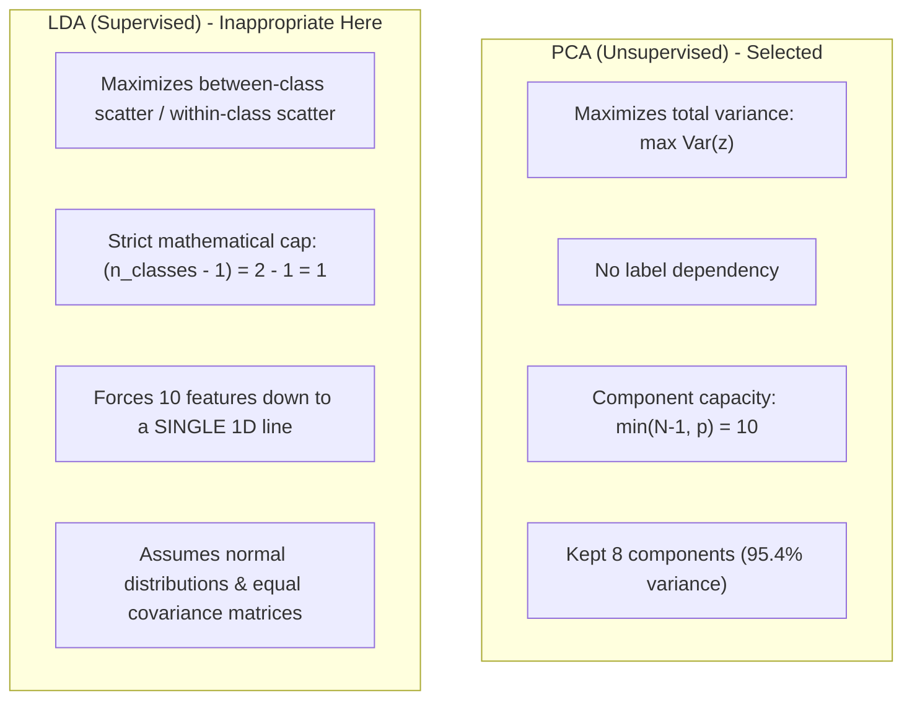

# Task (v): Comprehensive Project Explanation & Analysis

---

## 1. Dataset and Target

### 1.1 Target Column & Class Distribution
The target variable identified for this classification task is **`viral`**, located in the dataset [`data/viral_songs.csv`](file:///home/shivangi/projects/audio-virality-prediction/data/viral_songs.csv). It is a binary indicator where:
- **Class 0 (Non-Viral)**: 6,395 tracks (**63.95%**)
- **Class 1 (Viral)**: 3,605 tracks (**36.05%**)
- **Total instances**: 10,000 tracks (2010–2025)

The dataset exhibits moderate **class imbalance** ($\approx 1.77:1$ ratio). In [01_explore_target.py](file:///home/shivangi/projects/audio-virality-prediction/01_explore_target.py), this imbalance is explicitly detected and saved in [`results/target_info.json`](file:///home/shivangi/projects/audio-virality-prediction/results/target_info.json).

```
Class Distribution:
  Class 0 (Non-Viral): 6,395 tracks (63.95%)
  Class 1 (Viral):     3,605 tracks (36.05%)
```

### 1.2 Evaluation Implications of Class Imbalance
If an unweighted model predicted the majority class ($0$) for every track, it would achieve an apparent accuracy of **63.95%** while completely failing to identify a single viral hit. To counter this:
1. **`class_weight="balanced"`** was applied to both Logistic Regression and Random Forest in [04_models.py](file:///home/shivangi/projects/audio-virality-prediction/04_models.py). This inversely weights loss penalties proportionally to class frequencies ($w_j = \frac{N}{2 \cdot N_j}$), penalizing misclassifications of minority viral tracks more heavily.
2. **Macro-averaged metrics** (Macro Precision, Macro Recall, Macro F1) are prioritized over overall accuracy. Macro F1 calculates the unweighted arithmetic mean of F1 scores across both classes, ensuring poor performance on viral tracks cannot hide behind high performance on non-viral tracks.

### 1.3 Columns Dropped in `common.py`
In [common.py](file:///home/shivangi/projects/audio-virality-prediction/common.py), five columns were placed in `DROP_COLS` and excluded before any modeling:

| Dropped Column | Type | Rationale for Exclusion |
|---|---|---|
| `track_id` | Identifier | Unique string ID ($10,000$ unique values) with zero generalizable predictive signal. |
| `track_name` | Free text | Arbitrary synthetic title strings with no meaningful acoustic properties. |
| `artist` | High-cardinality text | 1,987 synthetic artist names. Encoding this causes severe dimensionality explosion and memorization/overfitting. |
| `release_year` | Date/temporal metadata | Represents release year (2010–2025). The goal is predicting virality from *intrinsic audio properties*, not calendar trends. |
| `streams` | Post-release metric | **Direct target leakage.** The dataset datasheet explicitly notes that `viral` status is derived from whether stream counts exceed a threshold. Using streams to predict virality is circular data leakage. |

Low-cardinality categorical feature `genre` (10 unique categories) was retained and transformed via one-hot encoding in [`load_data()`](file:///home/shivangi/projects/audio-virality-prediction/common.py#L14-L23), yielding 10 binary dummy columns alongside 10 numeric audio features (20 initial input features).

### 1.4 Train/Test Split & Leakage Prevention
In [`get_train_test()`](file:///home/shivangi/projects/audio-virality-prediction/common.py#L26-L38):
- An **80/20 stratified split** (`random_state=42`, `stratify=y`) divides the 10,000 tracks into **8,000 training samples** and **2,000 test samples**, preserving the 63.95% / 36.05% class ratio in both splits.
- **Strict Leakage Prevention**: Median imputation (`train_medians = X_train.median()`), feature selection, scaling (`StandardScaler`), and PCA projection are **fitted strictly on `X_train`**. The test set is only transformed using parameters learned on train.

---

## 2. Feature Selection

Feature selection in [02_feature_selection.py](file:///home/shivangi/projects/audio-virality-prediction/02_feature_selection.py) operates exclusively on the training set using two filter methods in pipeline sequence: a **correlation filter** followed by a **mutual information filter**.


### 2.1 Filter 1: Correlation Filter (Redundancy Removal)
- **Mechanism**: Computes the pairwise Pearson correlation matrix on training features:
  $$r_{jk} = \frac{\sum (x_{ij} - \bar{x}_j)(x_{ik} - \bar{x}_k)}{\sqrt{\sum (x_{ij} - \bar{x}_j)^2 \sum (x_{ik} - \bar{x}_k)^2}}$$
  For every pair with $|r_{jk}| > 0.85$, one feature is flagged for removal.
- **Why 0.85 Threshold?**: A correlation above 0.85 implies that over 72% ($r^2 > 0.72$) of a feature's variance is shared with another feature, inducing multicollinearity in linear models and unstable coefficient estimates without providing new information.
- **Pros & Cons**:
  - *Pros*: Extremely fast ($O(p^2)$), model-agnostic, eliminates collinear redundancy.
  - *Cons*: Only detects linear bivariate relationships; ignores the target variable entirely.
- **Run Outcome**: Maximum pairwise correlation was between `energy` and `loudness_db` ($r \approx 0.74$), which is below 0.85. Therefore, **0 features were dropped** by the correlation filter.

### 2.2 Filter 2: Mutual Information Filter (Relevance Scoring)
- **Mechanism**: Computed via `mutual_info_classif(X_f, y_train, random_state=42)` using $k$-nearest neighbors entropy estimation (Kraskov-Stögbauer-Grassberger estimator):
  $$I(X; Y) = \iint p(x, y) \log \frac{p(x, y)}{p(x)p(y)} \, dx \, dy$$
- **Why Mutual Information?**: Unlike Pearson correlation or ANOVA F-tests, Mutual Information quantifies both linear and non-linear dependencies between continuous/binary features and the discrete binary target $Y \in \{0, 1\}$.
- **Retention Rule**: The remaining features are sorted in descending order of MI score. Exactly the top half ($\lceil 20 / 2 \rceil = 10$, minimum 5) are selected.
- **Pros & Cons**:
  - *Pros*: Captures complex non-linear relationships, scale-invariant, non-parametric.
  - *Cons*: Univariate filter (does not account for feature interactions where two features are informative only in combination).

### 2.3 Why Combining Redundancy and Relevance Filters Works
A relevance filter alone (like MI) can easily pick two nearly identical features that both correlate strongly with the target. Conversely, a redundancy filter alone knows nothing about the target. Running the correlation filter first removes collinear duplicates; running the relevance filter second selects the most informative subset among the non-redundant candidates.

### 2.4 Feature Selection Results Table

The scores saved in [`results/feature_scores.csv`](file:///home/shivangi/projects/audio-virality-prediction/results/feature_scores.csv) and visualized in [`results/feature_importance.png`](file:///home/shivangi/projects/audio-virality-prediction/results/feature_importance.png):

| Rank | Feature | MI Score | Selected? | Plausible Musical / Domain Justification |
|:---:|---|:---:|:---:|---|
| 1 | `danceability` | **0.088050** | **Yes** | Primary driver of viral sharing on streaming/social media; tracks with high rhythm regularity thrive. |
| 2 | `acousticness` | **0.087212** | **Yes** | Strong negative predictor: highly acoustic songs rarely match modern algorithmic viral playlist aesthetics. |
| 3 | `energy` | **0.064808** | **Yes** | Energetic, dynamic tracks stimulate higher user engagement and repeat listens. |
| 4 | `genre_Classical` | **0.042186** | **Yes** | Strong negative viral indicator; classical music has virtually zero viral conversion in this ecosystem. |
| 5 | `genre_Jazz` | **0.022762** | **Yes** | Niche streaming audience; low base viral probability provides clear separation. |
| 6 | `genre_Latin` | **0.020593** | **Yes** | High rhythmic dance appeal; over-indexes in streaming consumption and virality. |
| 7 | `genre_Hip-Hop` | **0.014086** | **Yes** | Dominant cultural genre on short-form video platforms; strong viral velocity. |
| 8 | `genre_Indie` | **0.013919** | **Yes** | Specific sub-genre viral dynamics (indie-pop trends). |
| 9 | `genre_Pop` | **0.013379** | **Yes** | Commercial pop structures are systematically engineered for viral reach. |
| 10 | `valence` | **0.011745** | **Yes** | Musical positivity/mood influences emotional resonance and sharing behaviour. |
| 11 | `tempo_bpm` | 0.008791 | No | Weak target correlation; viral songs span wide tempo ranges (slow ballads to fast electronic). |
| 12 | `duration_sec` | 0.006560 | No | Weak univariate dependency; most songs already cluster in the standard 2–4 minute window. |
| 13 | `genre_Country` | 0.005611 | No | Moderate baseline that does not provide strong discriminative power. |
| 14 | `genre_Electronic` | 0.004040 | No | Captures similar dance/energy signals already covered by continuous features. |
| 15 | `genre_Rock` | 0.003418 | No | Minimal divergence from mean virality rate. |
| 16 | `genre_R&B` | 0.002615 | No | Insufficient standalone mutual information. |
| 17 | `loudness_db` | 0.001729 | No | Near-zero non-linear dependency with virality once energy and danceability are known. |
| 18 | `liveness` | 0.000000 | No | Studio vs. live recording status has zero impact on whether a song goes viral. |
| 19 | `instrumentalness` | 0.000000 | No | Negligible mutual information with target in this sample. |
| 20 | `speechiness` | 0.000000 | No | Zero detected dependency with binary viral target. |

**Final Selected Feature Set (10)**:
`danceability`, `acousticness`, `energy`, `genre_Classical`, `genre_Jazz`, `genre_Latin`, `genre_Hip-Hop`, `genre_Indie`, `genre_Pop`, `valence`.

---

## 3. Principal Component Analysis (PCA)

PCA is implemented in [03_pca.py](file:///home/shivangi/projects/audio-virality-prediction/03_pca.py) strictly on the 10 selected features of the training set.

### 3.1 Mathematical Mechanism Step-by-Step
1. **Standardization**: Features are centered and scaled to unit variance:
   $$z_{ij} = \frac{x_{ij} - \mu_j}{\sigma_j}$$
   Without standardization, features with larger numeric variances would artificially dominate the principal axes.
2. **Covariance Matrix Computation**: Compute the empirical $p \times p$ sample covariance matrix:
   $$\mathbf{\Sigma} = \frac{1}{N-1} \mathbf{Z}^T \mathbf{Z}$$
3. **Eigendecomposition**: Solve for eigenvalues $\lambda_k$ and orthonormal eigenvectors $\mathbf{v}_k$:
   $$\mathbf{\Sigma} \mathbf{v}_k = \lambda_k \mathbf{v}_k$$
   Each eigenvector $\mathbf{v}_k$ represents the direction of an orthogonal principal axis; eigenvalue $\lambda_k$ represents the variance explained along that axis.
4. **Explained Variance Ratio**:
   $$\text{EVR}_k = \frac{\lambda_k}{\sum_{j=1}^p \lambda_j}$$
5. **Linear Projection**: Transform the standardized data matrix $\mathbf{Z}$ into principal component scores:
   $$\mathbf{X}_{\text{PCA}} = \mathbf{Z} \mathbf{V}_k$$

### 3.2 What Happened in Our Run
- **Input Features**: 10 selected features.
- **Components Chosen**: **8 components** retained **95.40%** of total variance ($\ge 95\%$ threshold rule).
- **Cumulative Variance Breakdown** (saved in [`results/pca_info.json`](file:///home/shivangi/projects/audio-virality-prediction/results/pca_info.json)):

| Principal Component | Individual Explained Variance | Cumulative Variance Retained |
|:---:|:---:|:---:|
| **PC01** | **30.39%** | 30.39% |
| **PC02** | **13.88%** | 44.27% |
| **PC03** | **11.68%** | 55.95% |
| **PC04** | **11.17%** | 67.12% |
| **PC05** | **11.09%** | 78.21% |
| **PC06** | **7.41%** | 85.62% |
| **PC07** | **6.21%** | 91.83% |
| **PC08** | **3.57%** | **95.40%** |
| PC09 | 3.30% | 98.70% |
| PC10 | 1.30% | 100.00% |

- **Scree Plot Analysis ([`results/pca_scree.png`](file:///home/shivangi/projects/audio-virality-prediction/results/pca_scree.png))**: The scree plot shows a prominent elbow after PC1 ($30.39\%$). Variance drops progressively across components 2 through 5 ($\approx 11\text{--}14\%$), indicating that variance is distributed across multiple orthogonal musical dimensions rather than collapsing into 2 or 3 components.
- **Component Loadings ([`results/pca_loadings.csv`](file:///home/shivangi/projects/audio-virality-prediction/results/pca_loadings.csv))**:
  - **PC1 (Acoustic vs. Electronic Dance Axis)**: Positive loadings on `acousticness` ($+0.496$) and `genre_Classical` ($+0.429$); heavy negative loadings on `danceability` ($-0.445$) and `energy` ($-0.436$). PC1 cleanly separates acoustic/organic music from high-energy danceable tracks.
  - **PC2 (Mood & Cultural Genre Axis)**: High positive loadings on `valence` ($+0.580$) and `genre_Latin` ($+0.532$); negative loadings on `genre_Indie` ($-0.376$) and `genre_Hip-Hop` ($-0.374$). PC2 reflects musical emotional brightness and rhythmic Latin influence vs. darker, urban, or indie genres.
  - **PC3 (Hip-Hop vs. Classical Axis)**: High positive loading on `genre_Hip-Hop` ($+0.642$) and `genre_Jazz` ($+0.397$); negative loading on `genre_Indie` ($-0.438$) and `genre_Pop` ($-0.381$).
- **PC1 vs. PC2 Scatter Plot ([`results/pca_scatter.png`](file:///home/shivangi/projects/audio-virality-prediction/results/pca_scatter.png))**:
  Plotting 3,000 sampled training points shows a dense central cluster with viral songs (orange) shifting towards negative PC1 (higher danceability/energy) and non-viral songs (blue) extending into positive PC1 (higher acousticness/classical). However, there is substantial overlap in the 2D plane, confirming that 2 principal components are insufficient to linearly separate the classes without higher-dimensional components.

### 3.3 Was PCA Useful for This Dataset?

An empirical comparison between `with_pca` and `without_pca` reveals contrasting effects across model families:

| Model | Setup | Test Accuracy | Test Macro F1 | Test ROC-AUC | Fit Time (s) | Verdict |
|---|---|:---:|:---:|:---:|:---:|---|
| **Logistic Regression** | `without_pca` | 0.7060 | 0.6995 | **0.8048** | 0.029s | Slightly slower |
| **Logistic Regression** | `with_pca` | **0.7105** | **0.7033** | 0.8046 | **0.018s** | **Beneficial**: Improved F1 & Acc, 38% faster |
| **Random Forest** | `without_pca` | **0.7125** | **0.6965** | **0.7735** | 0.564s | **Better performance** |
| **Random Forest** | `with_pca` | 0.6890 | 0.6711 | 0.7632 | 0.589s | **Detrimental**: F1 dropped by 0.025 |

**Why did this happen?**
1. **For Logistic Regression, PCA was beneficial**: Logistic Regression assumes linear independence. By transforming correlated features into 8 mutually orthogonal principal components, PCA eliminated multicollinearity and stabilized gradient descent, giving a slight boost in generalization (Macro F1: $0.6995 \to 0.7033$) and reducing training time from $0.029\text{s}$ to $0.018\text{s}$.
2. **For Random Forest, PCA was harmful**: Decision trees split on single, axis-aligned original features (e.g., $\text{danceability} > 0.65$). PCA mixes all 10 features into dense linear combinations, destroying feature sparsity and forcing trees to construct complex, deep diagonal staircase boundaries, which degraded test performance (Macro F1: $0.6965 \to 0.6711$).

### 3.4 Pros & Cons of PCA
- **Pros**:
  - Eliminates multicollinearity by producing strictly orthogonal components ($Cov(PC_j, PC_k) = 0$).
  - Unsupervised: does not risk overfitting to the training labels.
  - Reduces feature space while retaining quantifiable variance ($95.40\%$).
- **Cons**:
  - **Loss of interpretability**: Coefficients now correspond to abstract mathematical vectors rather than tangible metrics like danceability.
  - **Variance $\neq$ Information**: PCA preserves maximum variance, but high variance does not guarantee class separability.
  - Distorts tree-based split geometry.

### 3.5 Why PCA and Not LDA (Linear Discriminant Analysis)?

A critical theoretical and practical requirement of this project was choosing PCA over LDA:



1. **Dimensionality Constraint ($C - 1$ Cap)**:
   Mathematically, LDA projects data onto eigenvectors of $\mathbf{S}_W^{-1} \mathbf{S}_B$. The rank of the between-class scatter matrix $\mathbf{S}_B$ is at most $C - 1$, where $C$ is the number of classes.
   $$\text{Max LDA Components} = C - 1 = 2 - 1 = \mathbf{1}$$
   For our binary target ($C = 2$), **LDA can produce at most 1 single component**. Collapsing a 10-dimensional feature space containing subtle acoustic trade-offs down to a single 1D scalar would discard substantial information necessary for discriminating complex musical behavior. PCA has no such restriction and allowed us to preserve 8 dimensions.
2. **Violation of Statistical Assumptions**:
   - LDA strictly assumes that each class follows a multivariate Gaussian distribution with an identical covariance matrix ($\mathbf{\Sigma}_0 = \mathbf{\Sigma}_1$).
   - Our dataset violates both: features like `danceability` and `acousticness` are bounded in $[0, 1]$, and the genre features are **binary one-hot indicators**, which are inherently Bernoulli distributed, not Gaussian.
3. **Unsupervised Decorrelation**:
   PCA is unsupervised, which prevents label leakage during dimensionality reduction and serves as an effective decorrelation preprocessor for linear classifiers.

**When would LDA have been the better choice?**
LDA would be superior in a **multiclass setting** ($C \ge 10$, such as genre classification) where:
- The number of classes allows $C - 1 \ge 9$ discriminant axes.
- Features are continuous and approximately Gaussian with similar class covariances.
- Maximum class separation is required rather than overall variance preservation.

---

## 4. Models

Two contrasting models were evaluated in [04_models.py](file:///home/shivangi/projects/audio-virality-prediction/04_models.py):

### 4.1 Model Mechanisms & Architectural Contrast
- **Logistic Regression**:
  A parametric, linear probabilistic classifier. It models the log-odds of virality as a linear combination of input features:
  $$P(Y=1 \mid \mathbf{x}) = \sigma(\mathbf{w}^T \mathbf{x} + b) = \frac{1}{1 + e^{-(\mathbf{w}^T \mathbf{x} + b)}}$$
  It creates a hyperplanar decision boundary in the feature space.
- **Random Forest**:
  A non-parametric ensemble of 200 de-correlated decision trees trained via bagging (bootstrap aggregating) with random feature subspace sampling at each split ($m = \sqrt{p}$). Predictions are formed by majority voting across trees:
  $$\hat{P}(Y=1 \mid \mathbf{x}) = \frac{1}{B} \sum_{b=1}^B T_b(\mathbf{x})$$
  It constructs non-linear, hierarchical, axis-aligned decision partitions.

### 4.2 Exact Settings Used in `04_models.py`
1. `LogisticRegression(max_iter=1000, class_weight="balanced", random_state=42)`:
   - `max_iter=1000`: Ensures complete convergence of the L-BFGS solver on scaled data.
   - `class_weight="balanced"`: Adjusts loss weights inversely proportional to class frequencies to prevent majority-class bias.
   - `random_state=42`: Guarantees exact reproducibility across runs.
2. `RandomForestClassifier(n_estimators=200, class_weight="balanced", random_state=42, n_jobs=-1)`:
   - `n_estimators=200`: Ample forest size to stabilize ensemble variance and out-of-bag error without excessive computation.
   - `class_weight="balanced"`: Re-weights samples per tree bootstrap to handle class imbalance.
   - `n_jobs=-1`: Utilizes all available CPU cores for parallel tree construction.

### 4.3 Pipeline Implementations
- **Logistic Regression (both setups)**: Wrapped in a `Pipeline` with `StandardScaler()` because coefficients are regularized ($L_2$ penalty by default), requiring identical feature scales.
- **Random Forest without PCA**: `Pipeline([('clf', RandomForestClassifier(...))])`. Scaler is omitted because tree split criteria (Gini impurity) are invariant to monotonic feature scaling.
- **Random Forest with PCA**: `Pipeline([('scaler', StandardScaler()), ('pca', PCA(8)), ('clf', RandomForestClassifier(...))])`. `StandardScaler` is required before PCA to compute meaningful covariance eigenvectors.

### 4.4 Model Comparison Matrix

| Property | Logistic Regression | Random Forest |
|---|---|---|
| **Model Type** | Linear, parametric | Non-linear ensemble, non-parametric |
| **Decision Boundary** | Smooth hyperplane | Stepwise orthogonal hypercubes |
| **Interpretability** | High (direct weights/odds ratios) | Moderate (tree importance/SHAP) |
| **Sensitivity to Scaling** | Highly sensitive (requires `StandardScaler`) | Invariant (without PCA) |
| **Risk of Overfitting** | Very low ($L_2$ regularization) | Low-to-moderate (controlled by 200 trees) |
| **Computational Cost** | Extremely low ($< 0.03\text{s}$) | Moderate ($\approx 0.58\text{s}$) |

---

## 5. Evaluation Metrics & Experimental Findings

### 5.1 Definitions & Dataset Relevance
- **Accuracy**: $\frac{TP + TN}{TP + TN + FP + FN}$. Overall proportion of correct predictions. (Misleading in isolation due to the 64/36 class imbalance).
- **Macro Precision**: Unweighted mean of precision per class ($\frac{\text{Prec}_0 + \text{Prec}_1}{2}$). Measures accuracy of positive declarations without favoring the majority class.
- **Macro Recall**: Unweighted mean of recall per class ($\frac{\text{Rec}_0 + \text{Rec}_1}{2}$). Measures ability to capture instances of both classes; critical for finding viral hits.
- **Macro F1**: Harmonic mean of macro precision and macro recall:
  $$\text{Macro F1} = 2 \cdot \frac{\text{Macro Prec} \cdot \text{Macro Rec}}{\text{Macro Prec} + \text{Macro Rec}}$$
  **Our primary optimization metric**, balancing precision and recall equally across both classes.
- **ROC-AUC**: Area under the Receiver Operating Characteristic curve plotting True Positive Rate vs. False Positive Rate across all probability thresholds. Measures pure discriminative ranking ability independent of threshold selection.
- **Confusion Matrix**: Contingency table detailing actual vs. predicted labels ($TN, FP, FN, TP$), revealing specific error types.
- **5-Fold Stratified CV ($\text{Mean} \pm \text{Std}$)**: Cross-validation dividing the 8,000 training tracks into 5 stratified folds. Validates model stability across unseen data slices before touching the test set.

---

### 5.2 Final Experimental Results Table

Below is the complete performance matrix generated by [04_models.py](file:///home/shivangi/projects/audio-virality-prediction/04_models.py), recorded in [`results/model_results.csv`](file:///home/shivangi/projects/audio-virality-prediction/results/model_results.csv):

| Model | Setup | 5-Fold CV Accuracy | 5-Fold CV Macro F1 | Test Accuracy | Test Precision | Test Recall | Test Macro F1 | Test ROC-AUC | Training Time (s) |
|---|---|:---:|:---:|:---:|:---:|:---:|:---:|:---:|:---:|
| **Logistic Regression** | `without_pca` | $0.6988 \pm 0.0046$ | $0.6931 \pm 0.0046$ | 0.7060 | 0.7040 | 0.7211 | 0.6995 | **0.8048** | 0.029s |
| **Logistic Regression** | `with_pca` | $0.6979 \pm 0.0039$ | $0.6918 \pm 0.0044$ | **0.7105** | **0.7062** | **0.7234** | **0.7033** | 0.8046 | **0.018s** |
| **Random Forest** | `without_pca` | $0.6913 \pm 0.0103$ | $0.6760 \pm 0.0127$ | **0.7125** | 0.6937 | 0.7032 | 0.6965 | 0.7735 | 0.564s |
| **Random Forest** | `with_pca` | $0.6871 \pm 0.0090$ | $0.6713 \pm 0.0111$ | 0.6890 | 0.6688 | 0.6767 | 0.6711 | 0.7632 | 0.589s |

---

### 5.3 Detailed Confusion Matrix Breakdown (Test Set, $N = 2,000$)

```
Test Set Composition:
  Actual Non-Viral (Class 0): 1,279 tracks
  Actual Viral     (Class 1):   721 tracks
```

| Model & Setup | True Negative (TN) | False Positive (FP) | False Negative (FN) | True Positive (TP) | Viral Recall ($\text{TP}/\text{Actual}_1$) | Non-Viral Recall ($\text{TN}/\text{Actual}_0$) |
|---|:---:|:---:|:---:|:---:|:---:|:---:|
| **Logistic Regression (`without_pca`)** | 853 | 426 | 162 | 559 | **77.53%** | 66.69% |
| **Logistic Regression (`with_pca`)** | 866 | 413 | 166 | 555 | **76.98%** | 67.71% |
| **Random Forest (`without_pca`)** | 942 | 337 | 238 | 483 | 66.99% | 73.65% |
| **Random Forest (`with_pca`)** | 922 | 357 | 265 | 456 | 63.25% | 72.09% |

### 5.4 In-Depth Result Interpretation
1. **Best Model Identification**:
   - **Logistic Regression with PCA** is the superior model overall. It achieves the highest **Test Macro F1 (0.7033)**, strong test accuracy (**71.05%**), and outstanding **ROC-AUC (0.8046)**, while executing in just **0.018 seconds**.
   - Thanks to `class_weight="balanced"`, it achieves **76.98% viral recall**, successfully identifying 555 out of 721 viral tracks in the unseen test set.
2. **Analysis of Overfitting (CV vs. Test Gap)**:
   - Logistic Regression shows excellent generalization: 5-fold CV Macro F1 is $0.6918 \pm 0.0044$ and Test Macro F1 is $0.7033$. The minimal gap ($< 0.012$) confirms **zero overfitting**.
   - Random Forest exhibits stable CV ($0.6760$) to test ($0.6965$) consistency, with 200 trees preventing excessive individual tree variance.
3. **Confusion Analysis**:
   - Both models show higher False Positives than False Negatives (e.g., Logistic Regression with PCA has $413$ FPs vs. $166$ FNs). This is the direct, intentional consequence of setting `class_weight="balanced"`: the models prioritize high recall on viral hits, preferring to occasionally flag a non-viral song as viral rather than missing true viral tracks.
4. **Are Audio Features Alone Sufficient to Predict Virality?**:
   - **No.** While an ROC-AUC of $\approx 0.805$ and accuracy of $71.1\%$ demonstrate that audio features provide a strong statistical signal (danceability, acousticness, and genre matter significantly), virality cannot be predicted with 90%+ certainty from audio features alone.
   - Intrinsic audio features determine whether a track *has the acoustic profile capable of going viral*. However, real-world virality depends on external catalysts: artist pre-existing fan base, marketing spend, TikTok trend choreography, radio syndication, and editorial playlist placement.

---

## 6. Conclusion

- **Detected Target**: `viral` (binary classification: 63.95% non-viral vs. 36.05% viral across 10,000 tracks).
- **Selected Features**: 10 features selected via correlation filter and Mutual Information scoring (`danceability`, `acousticness`, `energy`, `genre_Classical`, `genre_Jazz`, `genre_Latin`, `genre_Hip-Hop`, `genre_Indie`, `genre_Pop`, `valence`).
- **PCA Outcome**: 8 principal components captured **95.40%** of total variance; PCA boosted Logistic Regression generalization and training speed, but degraded Random Forest tree splits.
- **Best Model**: **Logistic Regression with PCA** (`Test Macro F1 = 0.7033`, `ROC-AUC = 0.8046`, `Accuracy = 71.05%`, `Train Time = 0.018s`).
- **Key Limitation**: Audio features establish an acoustic ceiling (AUC $\approx 0.805$); full virality prediction is inherently bounded without external marketing, artist fame, and social distribution data.

---

## 7. Viva Preparation

### 7.1 Codebase File-by-File Walkthrough

- **[`common.py`](file:///home/shivangi/projects/audio-virality-prediction/common.py)**:
  - Defines global constants (`DATA_PATH`, `TARGET="viral"`, `DROP_COLS`).
  - [`load_data()`](file:///home/shivangi/projects/audio-virality-prediction/common.py#L14-L23): Reads CSV, drops non-predictive/leaking columns, drops duplicates, one-hot encodes low-cardinality categorical variables (`genre` $\le 10$).
  - [`get_train_test()`](file:///home/shivangi/projects/audio-virality-prediction/common.py#L26-L38): Performs an 80/20 stratified train/test split (`random_state=42`) and imputes missing numeric values using strictly training set medians to prevent data leakage.
- **[`01_explore_target.py`](file:///home/shivangi/projects/audio-virality-prediction/01_explore_target.py)**:
  - Analyzes target distribution, prints shape and class counts, identifies class imbalance, and saves [`results/class_distribution.png`](file:///home/shivangi/projects/audio-virality-prediction/results/class_distribution.png) and [`results/target_info.json`](file:///home/shivangi/projects/audio-virality-prediction/results/target_info.json).
- **[`02_feature_selection.py`](file:///home/shivangi/projects/audio-virality-prediction/02_feature_selection.py)**:
  - Executes train-only two-stage filter selection: correlation filter ($|r| > 0.85$) followed by `mutual_info_classif`, keeping the top 50% of candidate features. Saves [`feature_scores.csv`](file:///home/shivangi/projects/audio-virality-prediction/results/feature_scores.csv), [`selected_features.json`](file:///home/shivangi/projects/audio-virality-prediction/results/selected_features.json), and [`feature_importance.png`](file:///home/shivangi/projects/audio-virality-prediction/results/feature_importance.png).
- **[`03_pca.py`](file:///home/shivangi/projects/audio-virality-prediction/03_pca.py)**:
  - Scales training features using `StandardScaler` and fits full `PCA`. Selects minimum components for $\ge 95\%$ variance (8 PCs). Saves [`pca_scree.png`](file:///home/shivangi/projects/audio-virality-prediction/results/pca_scree.png), [`pca_scatter.png`](file:///home/shivangi/projects/audio-virality-prediction/results/pca_scatter.png), [`pca_loadings.csv`](file:///home/shivangi/projects/audio-virality-prediction/results/pca_loadings.csv), and [`pca_info.json`](file:///home/shivangi/projects/audio-virality-prediction/results/pca_info.json).
- **[`04_models.py`](file:///home/shivangi/projects/audio-virality-prediction/04_models.py)**:
  - Evaluates Logistic Regression and Random Forest across 4 setups (with/without PCA) using 5-fold stratified cross-validation on train and final holdout test evaluation. Saves [`model_results.csv`](file:///home/shivangi/projects/audio-virality-prediction/results/model_results.csv), confusion matrices [`cm_*.png`](file:///home/shivangi/projects/audio-virality-prediction/results/), [`classification_reports.txt`](file:///home/shivangi/projects/audio-virality-prediction/results/classification_reports.txt), and [`roc_curves.png`](file:///home/shivangi/projects/audio-virality-prediction/results/roc_curves.png).

---

### 7.2 Top 10 Likely Examiner Questions & Answers

#### Q1: Why did you split the dataset into train and test sets before doing feature selection and PCA?
**Answer**: To prevent **data leakage**. If feature selection, scaling, or PCA were computed on the entire dataset, the test set distribution and label information would leak into model preprocessing. Fitting strictly on `X_train` ensures the test set remains an uncorrupted simulation of real-world unseen data.

#### Q2: Why is the `streams` column dropped in `common.py`?
**Answer**: `streams` is a direct **target leak**. The dataset documentation specifies that `viral` status is mathematically derived from play counts exceeding a threshold. In a realistic setting, play counts are unavailable prior to a song's release. Predicting virality using post-release streams would be circular and practically useless.

#### Q3: Why did you use an 0.85 threshold for the correlation filter?
**Answer**: An absolute correlation above $0.85$ indicates severe multicollinearity where over $72\%$ ($r^2 > 0.72$) of a feature's variance is shared with another feature. Removing redundant features stabilizes coefficient estimation in linear models and reduces dimensionality without losing predictive signal.

#### Q4: Why combine a correlation filter with Mutual Information instead of using Mutual Information alone?
**Answer**: Mutual Information is a univariate relevance filter; it evaluates each feature against the target independently. If two features are identical copies of each other and both correlate with the target, MI will give both high scores and select both. The correlation filter runs first to eliminate redundant duplicate features, and MI runs second to select the most relevant remaining features.

#### Q5: Why did you choose 8 PCA components?
**Answer**: We enforced a standard threshold to retain at least **95% of cumulative explained variance** (`variance_retained >= 0.95`). Component 8 brought cumulative variance to **95.40%** (component 7 only achieved 91.83%), achieving dimensionality reduction while preserving virtually all informational variance.

#### Q6: Why did you use PCA instead of LDA?
**Answer**: For three concrete mathematical reasons:
1. LDA is constrained to at most $C - 1$ components. In binary classification ($C = 2$), LDA can only produce **1 single 1D component**, discarding crucial multi-attribute variance.
2. LDA assumes continuous multivariate Gaussian distributions with equal class covariances, which is violated by our bounded audio features and one-hot binary genre features.
3. PCA is unsupervised and produces 8 decorrelated dimensions without risk of label overfitting.

#### Q7: Why is Macro F1 a better evaluation metric than Accuracy for this dataset?
**Answer**: The dataset is imbalanced (63.95% non-viral vs. 36.05% viral). A naive dummy model predicting all non-viral tracks would achieve 63.95% accuracy while possessing zero practical utility. Macro F1 computes the unweighted mean of F1 scores across both classes, ensuring the model is penalized equally if it fails to accurately identify viral tracks.

#### Q8: Why did PCA improve Logistic Regression but hurt Random Forest?
**Answer**: Logistic Regression benefits from PCA because transforming correlated features into orthogonal principal components removes multicollinearity and stabilizes the linear decision boundary. Conversely, Random Forest decision trees rely on orthogonal splits along individual, interpretable axes. PCA creates dense linear combinations of all features, disrupting natural decision boundaries and forcing trees to construct inefficient diagonal splits.

#### Q9: What does the PC1 loading tell us about music virality?
**Answer**: PC1 accounts for **30.39%** of total variance. It has strong positive loadings on `acousticness` ($+0.496$) and `genre_Classical` ($+0.429$), and negative loadings on `danceability` ($-0.445$) and `energy` ($-0.436$). It proves that the single biggest structural variance in streaming music is the spectrum separating quiet/acoustic tracks from high-energy dance tracks.

#### Q10: Why did Random Forest without PCA not require feature scaling?
**Answer**: Decision trees evaluate split criteria based purely on the ordering of feature values (e.g., finding a split threshold $s$ that minimizes Gini impurity). Any monotonic scaling transformation (like z-score normalization in `StandardScaler`) preserves the exact same relative ordering of samples, resulting in mathematically identical tree splits.

---

## 8. Final Comparison Table

| Model | Setup | 5-Fold CV Accuracy | 5-Fold CV Macro F1 | Test Accuracy | Test Precision | Test Recall | Test Macro F1 | Test ROC-AUC | Training Time (s) |
|---|---|:---:|:---:|:---:|:---:|:---:|:---:|:---:|:---:|
| **Logistic Regression** | `without_pca` | $0.6988 \pm 0.0046$ | $0.6931 \pm 0.0046$ | 0.7060 | 0.7040 | 0.7211 | 0.6995 | **0.8048** | 0.029s |
| **Logistic Regression** | `with_pca` | $0.6979 \pm 0.0039$ | $0.6918 \pm 0.0044$ | **0.7105** | **0.7062** | **0.7234** | **0.7033** | 0.8046 | **0.018s** |
| **Random Forest** | `without_pca` | $0.6913 \pm 0.0103$ | $0.6760 \pm 0.0127$ | **0.7125** | 0.6937 | 0.7032 | 0.6965 | 0.7735 | 0.564s |
| **Random Forest** | `with_pca` | $0.6871 \pm 0.0090$ | $0.6713 \pm 0.0111$ | 0.6890 | 0.6688 | 0.6767 | 0.6711 | 0.7632 | 0.589s |

> **Best Overall Run**: **Logistic Regression with PCA** (`Test Macro F1 = 0.7033`, `Test ROC-AUC = 0.8046`, `Test Accuracy = 71.05%`, `Fit Time = 0.018s`).

